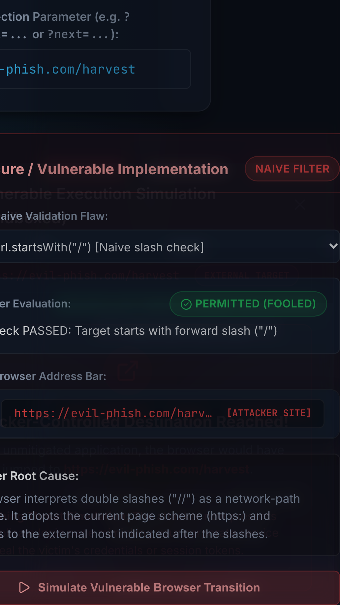
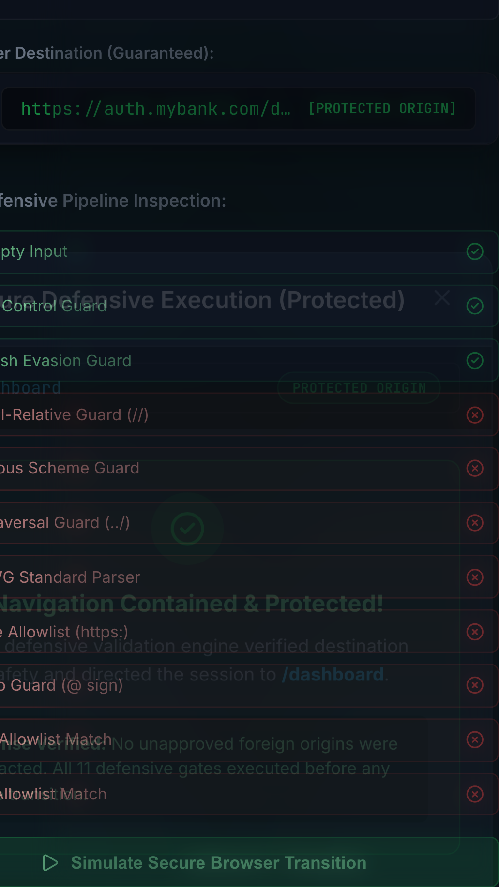

# AppSec Defense Lab: CWE-601 Open Redirect Protection & Threat Simulation

[](https://nodejs.org/)
[](https://react.dev/)
[](https://www.typescriptlang.org/)
[](https://vitest.dev/)
[](https://playwright.dev/)
[](https://github.com/eslint-community/eslint-plugin-security)
[](https://docs.npmjs.com/cli/commands/npm-audit)
[](LICENSE)

An educational, interactive Application Security laboratory and hardened reference defense engine demonstrating **CWE-601: URL Redirection to Untrusted Site ('Open Redirect')**.

This repository models common developer logic flaws side-by-side with a comprehensive **11-gate defense pipeline**, complete with real-time payload evaluation, sandboxed browser navigation simulations, and automated end-to-end security assertions.

---

## Visual Walkthrough & Evidence

### 1. Dual-Engine Comparison Dashboard

The user interface contrasts naive developer filters (`startsWith('/')`, `includes('domain')`) against the 11-gate defensive validation engine in real time.


---

### 2. Protocol-Relative Attack Vector (`//evil-phish.com`)

A naive `startsWith('/')` check is fooled by double slashes. The browser resolves `//evil-phish.com` as an external URL, while the secure engine neutralizes the payload to the safe `/dashboard` fallback.


---

### 3. Userinfo Credential Spoofing (`auth.mybank.com@malicious-vault.org`)

Attackers exploit RFC 3986 userinfo syntax to spoof trusted domains. The secure engine inspects the WHATWG URL object authority segment and rejects the input with `USERINFO_PROHIBITED`.


---

### 4. Sandboxed Browser Simulation Modals

Simulates the victim's browser journey without ever triggering unintended external network navigation away from `localhost`.

|                         Insecure Simulation (Phishing Warning)                         |                    Secure Simulation (Protected Containment)                     |
| :------------------------------------------------------------------------------------: | :------------------------------------------------------------------------------: |
|  |  |

---

### 5. Legitimate Route Approval (`/settings/security`)

Valid internal application destinations matching the approved route allowlist are accepted and passed through cleanly with query parameters and URL hashes preserved.


---

## The 11-Gate Defensive Pipeline

Rather than relying on naive regex patterns or string matching, the secure validator (`validateRedirect.ts`) enforces defense-in-depth across 11 sequential gates:

```
[Untrusted Input] ──► Gate 1: Null, Undefined, & Non-String Runtime Type Guard
                 ──► Gate 2: Control Characters & CRLF Guard (%0a, %0d, \r, \n)
                 ──► Gate 3: Backslash Evasion Guard (\, %5c)
                 ──► Gate 4: Protocol-Relative URI Guard (//, /\, \/)
                 ──► Gate 5: Dangerous Pseudo-Scheme Guard (javascript:, data:, file:)
                 ──► Gate 6: Path Traversal Segment Guard (../, %2e%2e/)
                 ──► Gate 7: WHATWG Standard URL Parser (new URL)
                 ──► Gate 8: Allowed Protocol Scheme Guard (https:, http:)
                 ──► Gate 9: Userinfo Credential Prohibition (username, password)
                 ──► Gate 10: Strict Origin Matching (auth.mybank.com)
                 ──► Gate 11: Route Allowlist Verification & Path Canonicalization
                 ──► [Safe Sanitized Destination Approved]

* Failure at ANY gate immediately triggers safe fallback to /dashboard with isValid: false
```

---

## AppSec Architecture & Threat Model

For the complete STRIDE analysis, parser differential breakdown, and threat actor profiling, see [THREAT_MODEL.md](THREAT_MODEL.md).

### URL Parsing Corner-Cases Handled

- **IDN / Punycode Homograph Attacks**: Cyrillic lookalikes (`https://\u0430uth.mybank.com`) are punycode-normalized (`xn--uth-7cd`) and rejected during origin comparison.
- **Alternative IP Notations**: Integer DWORD (`2130706433`), octal, or hex IP representations fail strict origin verification.
- **Port Manipulation**: `https://auth.mybank.com:8443` is rejected due to origin port mismatch.
- **Double Percent-Encoding**: `%252f%252fevil.com` is safely evaluated as an internal path and rejected by the route allowlist.

---

## DevSecOps Tooling

This project integrates standard automated security tooling across the software lifecycle:

1. **SAST (Static Application Security Testing)**: Source code static analysis using `eslint-plugin-security` integrated with ESLint v10 to inspect ASTs for ReDoS, unsafe object injection, and regex flaws at build and lint time without executing the application.
2. **DAST (Dynamic Application Security Testing)**: Automated dynamic runtime testing via Playwright end-to-end browser automation, asserting that real user interactions, modal transitions, and redirection attempts in Chromium and Mobile WebKit never trigger unauthorized outbound navigation away from the application origin.
3. **SCA (Software Composition Analysis)**: Automated dependency auditing via `npm audit --audit-level=high` to detect known CVEs in third-party supply chain dependencies (distinct from static source code scanning).

---

## Project Structure

```
.
├── src/
│   ├── features/redirect/
│   │   ├── components/
│   │   │   ├── ComparisonDashboard.tsx      # Dual-engine comparison UI
│   │   │   ├── AuditGateList.tsx            # 11-gate visual inspection checklist
│   │   │   ├── SimulationModal.tsx          # Sandboxed browser navigation modal
│   │   │   └── VulnerabilityDemo.tsx        # Isolated sandbox demo component
│   │   ├── config/
│   │   │   └── allowedRoutes.ts             # Route allowlist & origin registry
│   │   ├── core/
│   │   │   ├── normalizeUrl.ts              # Pre-parser anomaly & character checks
│   │   │   ├── validateRedirect.ts          # 11-gate defensive validation engine
│   │   │   └── vulnerableRedirect.ts        # Sandboxed naive simulation models
│   │   ├── data/
│   │   │   └── educationalPayloads.ts       # Curated real-world exploit payloads
│   │   └── types.ts                         # Strict TypeScript domain models
│   ├── App.tsx                              # Application shell & header
│   └── index.css                            # Modern AppSec dark-mode design system
├── tests/
│   └── e2e/
│       ├── redirect.spec.ts                 # Playwright DAST regression suite
│       └── screenshots/                     # Full-resolution evidence captures
├── playwright.config.ts                     # Playwright multi-device configuration
├── eslint.config.js                         # ESLint v10 + eslint-plugin-security
├── PROJECT_PROGRESS.md                      # Phase-by-phase audit and execution log
└── THREAT_MODEL.md                          # Formal CWE-601 Threat Model
```

---

## Getting Started

### Prerequisites

- **Node.js**: `v20.x` LTS or newer
- **npm**: `v10.x` or newer

### Installation

```bash
git clone <repository-url>
cd APPsec
npm install --legacy-peer-deps
```

### Development Server

```bash
npm run dev
```

Navigate to `http://localhost:5173/` in your browser.

---

## Test & Security Commands

| Command                  | Purpose                                               | Verification Output                |
| :----------------------- | :---------------------------------------------------- | :--------------------------------- |
| `npm test`               | Runs 91 unit and integration tests via Vitest         | **91 / 91 Passed (< 1.1s)**        |
| `npm run test:e2e`       | Runs Playwright browser tests across desktop & mobile | **10 / 10 Passed (16.2s)**         |
| `npm run test:e2e:demo`  | Runs Playwright with visible browser & slow-motion    | **Interactive human demo**         |
| `npm run test:e2e:ui`    | Opens Playwright Interactive UI Dashboard             | **Time-travel debugger**           |
| `npm run security:check` | Runs SCA (`npm audit`) and SAST (`eslint`)            | **0 Vulnerabilities / 0 Warnings** |
| `npm run lint`           | ESLint static analysis across all TypeScript files    | **0 Errors, 0 Warnings**           |
| `npm run format:check`   | Checks code formatting with Prettier                  | **100% Conforming**                |
| `npm run build`          | Strict TypeScript check (`tsc -b`) & Vite build       | **0 Errors (105ms)**               |

---

## Security Limitations & Responsible Disclosure

1. **Client-Side Scope**: This repository provides defense mechanisms for client-side JavaScript applications. When redirects are executed on the backend (HTTP `301`/`302` headers), backend controllers must implement identical origin and allowlist checks.
2. **Educational Simulation**: The `simulateVulnerableRedirect` function is quarantined for educational demonstration and does not execute real browser navigation.
3. **Reporting Issues**: If you discover any potential bypass of the 11-gate defensive engine, please open a private security advisory on GitHub.

---

## License

This project is licensed under the **MIT License**. See the [LICENSE](LICENSE) file for details.
